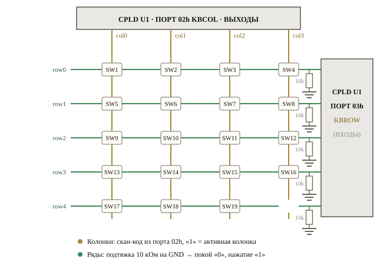
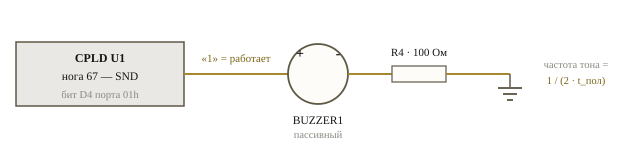
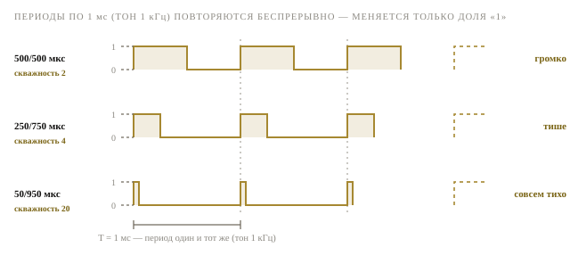
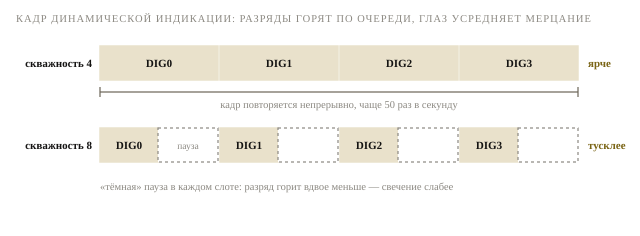
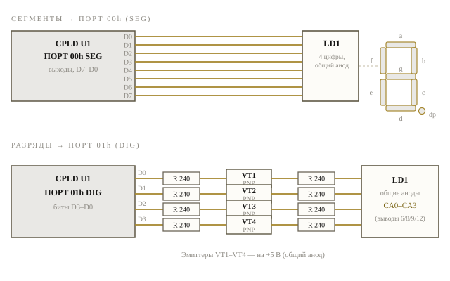
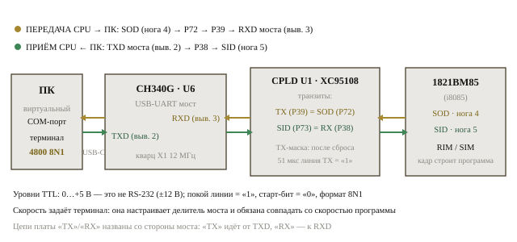
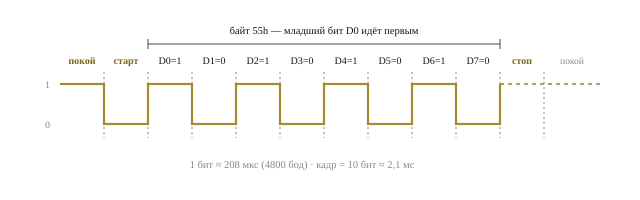

# Инструкция по программированию — retro_PCLD

**1821ВМ85 (i8085) · CPLD XC95108 · 2,5 МГц**

Учебная плата на процессоре 1821ВМ85 — программном аналоге Intel 8085 — со всей
логикой поддержки на CPLD. В этой инструкции: как устроены память и порты
ввода-вывода, как опросить матричную клавиатуру, синтезировать тон и управлять
его громкостью, вывести цифру на индикатор и обменяться байтами с ПК через
USB-UART мост. Все примеры — короткие фрагменты на ассемблере 8085 с
построчными комментариями.

| | |
|---|---|
| **CPU** | 1821ВМ85 · такт 2,5 МГц · машинный такт T = 400 нс |
| **ПАМЯТЬ** | ПЗУ 32 КБ (flash A29040B) · ОЗУ 32 КБ (SRAM UM61512) |
| **Порты** | SEG 00h · DIG/SND 01h · KBCOL 02h · KBROW 03h |
| **СОМ** | SID/SOD → CH340G · USB Type-C · 4800 8N1 |

*retro_PCLD_board V2 · 2026*

---

## Раздел 1 · Доступ к памяти

Процессор 1821ВМ85 адресует 64 КБ памяти. Линия IO/M̄ (нога 34) разделяет два
мира: при IO/M̄ = 0 выполняется обращение к памяти, при IO/M̄ = 1 — к портам
ввода-вывода. Старший бит адреса A15 делит память ровно пополам, и дешифрация
выбрана предельно простой: любой адрес с A15 = 0 попадает в ПЗУ, любой с
A15 = 1 — в ОЗУ. Никаких «слепых зон» и теневых копий: всё 64-килобайтное
пространство покрыто без дыр.

Для программы это выглядит классически. В нижней половине живёт постоянная
память: монитор fw_mon размещён с самого начала ПЗУ, и после сброса процессор
начинает выполнение с адреса 0000h. В верхней половине — оперативная память:
переменные, буферы и стек (указатель стека имеет смысл инициализировать в
верхнюю область ОЗУ). Записать байт в ПЗУ не получится даже при желании:
защита аппаратная — вход /WE флэш-кристалла подтянут резистором R18 к питанию,
а CPLD цикл записи при A15 = 0 просто игнорирует. Запись в ОЗУ выполняет сам
CPLD-трансивер: для программы это обычные команды с операндом M — транзакция
полностью прозрачна.

| Диапазон | Объём | Устройство | Что важно знать |
|---|---|---|---|
| `0000h–7FFFh` | 32 КБ | **ПЗУ** — flash A29040B (512К×8) | Виден образ с нулевого смещения кристалла. Здесь монитор fw_mon; старт программы — адрес 0000h. Запись невозможна аппаратно. |
| `8000h–FFFFh` | 32 КБ | **ОЗУ** — SRAM UM61512AK-15 (64К×8) | Кристалл отвечает своей верхней половиной. Переменные, буферы, стек. Запись и чтение — обычными командами. |
| `IO/M̄ = 1` | 256 портов | **Порты** — регистры CPLD | Команды IN/OUT. Дешифрация по младшим трём битам адреса; реально используются порты 00h–03h — см. раздел 2. |

```asm
        LXI  H,8000h   ; HL указывает на начало ОЗУ
        MVI  M,55h     ; записать 55h в ячейку (HL)
        MOV  A,M       ; прочитать её обратно в аккумулятор
        LXI  H,0100h   ; HL — любой адрес ПЗУ
        MOV  B,M       ; прочитать байт ПЗУ в регистр B
```

*Фрагмент 1 · Запись в ОЗУ и чтение из ПЗУ. Буква M в операндах — это ячейка
памяти, на которую указывает пара HL.*

---

## Раздел 2 · Доступ к портам

Ввод-вывод выполняется командами `OUT port` и `IN port`: процессор выставляет
IO/M̄ = 1 и номер порта на шину адреса. CPLD дешифрует только три младших бита
защёлкнутого адреса (A2–A0), поэтому каждый регистр «зеркалится» каждые
8 адресов: 00h, 08h, 10h… F8h — это один и тот же регистр SEG. Во всех
примерах используются канонические адреса 00h–03h — придерживайтесь их, чтобы
не путаться. Четыре регистра закрывают всё периферийное хозяйство платы:
индикатор, звук и клавиатуру. Последовательный канал с ПК — исключение: он
подключён не к портам, а к специальным ногам самого процессора — об этом
раздел 3.

После сброса CPLD сам включает все сегменты и все четыре разряда — индикатор
показывает «8. 8. 8. 8.». Это удобная сигнализация: если после подачи питания
индикатор погас, значит программа уже начала работу и что-то записала в порты.
Колонки клавиатуры при сбросе выключены (0000), тишина на излучателе. Записи
в порты 04h–07h игнорируются. А вот чтение требует дисциплины: **читать можно
только порт 03h** — при чтении любого другого порта шину никто не драйвит, и
процессор захватит плавающий (непредсказуемый) уровень.

| Порт | Имя | R/W | Биты | Назначение |
|---|---|---|---|---|
| `00h` | `SEG` | запись | `D7–D0` | Сегменты: D0→a, D1→b, D2→c, D3→d, D4→e, D5→f, D6→g, D7→dp. **«1» = сегмент горит** |
| `01h` | `DIG/SND` | запись | `D3–D0` | Разряды 0–3: «1» = разряд включён (драйверы VT1–VT4, общий анод) |
| `01h` | `DIG/SND` | запись | `D4` | Звук: звучит **чередование «0» и «1»** на D4 (см. п. 2.2) — постоянный уровень молчит. Биты D7–D5 не сохраняются |
| `02h` | `KBCOL` | запись | `D3–D0` | Колонки клавиатуры: «1» = колонка активна. После сброса 0000 (все выключены) |
| `03h` | `KBROW` | **чтение** | `D4–D0` | Ряды 0–4: «1» = нажата кнопка в активной колонке. Биты D7–D5 читаются как 000 |
| `04h–07h` | — | — | — | Резерв (аппаратный UART удалён). Записи игнорируются, читать нельзя |

---

### 2.1. Клавиатура

Кнопки платы организованы матрицей 5×4: девятнадцать кнопок SW1–SW19 стоят на
пересечениях пяти рядов и четырёх колонок (двадцатая кнопка SW20 — RESET — в
матрицу не входит, она подключена к входу сброса отдельно). Колонки col0–col3 —
это выходы CPLD, собранные в порт 02h (KBCOL): единица в бите D3–D0 «заводит»
соответствующую колонку. Ряды row0–row4 — входы, собранные в порт 03h (KBROW):
их состояние программа читает битами D4–D0.

На рисунке видно главное свойство матрицы: **ряды подтянуты резисторами R21–R25
по 10 кОм к земле**, поэтому в покое на всех рядах уровень логического «0».
Когда программа выставляет скан-код (единицу на одной из колонок) и кнопка на
пересечении с этой колонкой нажата, цепь колонка → кнопка → ряд замыкается, и
на входе ряда появляется «1». Так один проход опроса — записать скан-код,
прочитать ряды — проверяет сразу до пяти кнопок и сообщает и столбец, и строку.



*Рис. 1 · Матрица клавиатуры 5×4. Янтарные линии — колонки (выходы, порт 02h),
зелёные — ряды (входы, порт 03h). Номер кнопки: SW = ряд × 4 + колонка + 1.*

```asm
        MVI  A,01h     ; скан-код: активна колонка 0
        OUT  02h       ; выставить скан-код (порт KBCOL)
        IN   03h       ; прочитать ряды: 1 = нажата
        ANI  1Fh       ; оставить только биты рядов D4–D0
        JNZ  KEY00     ; есть нажатие → переход к обработчику
```

*Фрагмент 2 · Опрос одной колонки. Перебирая колонки 01h → 02h → 04h → 08h,
программа находит конкретную кнопку: пересечение активной колонки и ненулевого
ряда.*

---

### 2.2. Звуковой излучатель (пассивный)

Излучатель — **пассивный**: генератора внутри нет, мембрана звучит ровно так,
как её раскачает внешний сигнал. Линия SND (нога 67 CPLD, бит D4 порта 01h)
соединена с излучателем, второй его вывод — через резистор R4 100 Ом на землю.
Уровень «1» на SND прижимает мембрану, «0» отпускает. Постоянный уровень звука
не даст — для слышимого тона нужен переменный ток, поэтому программа формирует
**меандр**: с равными интервалами переключает бит D4 то в «1», то в «0».



*Рис. 2 · Подключение излучателя: CPLD (SND, нога 67) → BUZZER1 (+/−) →
R4 100 Ом → GND.*

```asm
TONE:   MVI  B,00h     ; база: разряды погашены, звук «0»
LOOP:   MOV  A,B
        ORI  10h       ; бит D4 = 1 — излучатель работает
        OUT  01h       ; (порт DIG/SND)
        CALL DELAY     ; полупериод, например ~0,5 мс
        MOV  A,B       ; бит D4 = 0 — тишина
        OUT  01h
        CALL DELAY
        JMP  LOOP
```

*Фрагмент 3 · Меандр на излучателе: f = 1/(2·t_пол). Подбирая длительность
DELAY, меняем высоту тона.*

Как выбрать DELAY. При тактовой 2,5 МГц машинный такт T = 400 нс, а типичный
цикл задержки «DCR + JNZ» занимает около 6 мкс на итерацию. Восьмибитный
счётчик примерно до 80 итераций даст полупериод ~0,5 мс — тон около 1 кГц.
Для низких тонов применяют вложенные (16-битные) счётчики. Важная деталь
фрагмента 3: запись в порт 01h перезаписывает *весь* байт, включая разряды
индикатора. Поэтому «базу» (состояние разрядов без звука) держат в регистре B
и каждый раз накладывают на неё бит D4 командой ORI — тогда звук и индикация
не мешают друг другу.

Громкость: скважность. Амплитуда на SND всегда одна — 0 или +5 В, но мембрана
слышит *среднюю* мощность за период. Поэтому громкость регулируют, не трогая
частоту: долей времени, когда на линии «1» — это называется изменением
скважности (ШИМ). Меандр из фрагмента 3 («1» и «0» поровну) раскачивает
мембрану сильнее всего — это максимум громкости. Если при том же периоде
держать «1» меньше, чем «0», тон сохранится прежним, а звук станет тише:
период 1 мс (1 кГц): 500/500 мкс — громко, 250/750 мкс — тише, 50/950 мкс —
совсем тихо. Чем короче «единицы», тем тише — вплоть до почти полной тишины.



*Рис. 3 · Скважность периодического сигнала — показаны три периода подряд по 1 мс (тон 1 кГц): меняется только доля времени «1» (залитые участки), а с ней и средняя мощность, раскачивающая мембрану, — от громкого меандра (скважность 2) до почти полной тишины (скважность 20).*

---

### 2.3. Семисегментный дисплей

Индикатор LD1 — четыре цифры **с общим анодом**: у каждой цифры все сегменты
соединены общим «плюсом» (анодом), а катоды сегментов a–g и точки dp выведены
отдельно. Сегментные линии собраны в порт 00h (SEG): бит D0 зажигает сегмент
a, D1 — b, … D6 — g, D7 — точка dp. В регистре «1» = сегмент горит — CPLD сам
выполняет инверсию, нужную общему аноду. Разряды собраны в порт 01h: биты
D3–D0 включают разряды 0–3, каждый через собственный PNP-ключ VT1–VT4
(КТ502А), подающий питание на общий анод своей цифры.

Схема индикации — **динамическая**: одновременно горит один разряд. Чтобы глаз
видел все четыре цифры, разряды перебирают по кругу со сменой кода сегментов,
обновляя каждый разряд чаще ~50–100 раз в секунду. Пока программа не трогает
порты, CPLD показывает «8.» во всех разрядах — после сброса сегменты FFh и
разряды F включены.

Яркость — та же математика, что и с громкостью. При динамической индикации
каждый разряд горит лишь часть времени кадра: при переборе четырёх разрядов
это четверть (скважность 4), и глаз усредняет мерцание в ровное свечение.
Если ввести в цикл сканирования «тёмную» паузу или укоротить фазу включения
разряда, свечение станет тусклее — яркость меняется без изменения кодов
сегментов. Важно лишь держать частоту кадра выше ~50 Гц, чтобы исчезло
заметное мерцание.



*Рис. 4 · Кадр динамической индикации: разряды горят по очереди, каждый — 1/4 времени кадра (скважность 4). «Тёмная» пауза в каждом слоте (нижняя дорожка, скважность 8) укорачивает фазу включения — индикация тусклее при тех же кодах сегментов.*



*Рис. 5 · Сборка портов дисплея: слева — сегментные линии a–g, dp в порт 00h;
снизу — драйверы разрядов: CPLD → R 240 → VT (PNP, эмиттер на +5 В) → R 240 →
общий анод CA0–CA3.*

```asm
        LXI  H,SEGTAB  ; HL → таблица кодов сегментов
        MOV  A,M       ; A = код цифры (например, «0» = 3Fh)
        OUT  00h       ; сегменты → порт SEG
        MVI  A,01h     ; номер разряда: 01h / 02h / 04h / 08h
        OUT  01h       ; зажечь разряд (порт DIG/SND)
```

*Фрагмент 4 · Вывод цифры в разряд 0. Чтобы вывести цифру в другой разряд,
поменяйте константу во втором MVI A — 01h, 02h, 04h или 08h.*

Коды сегментов для шестнадцати цифр собраны в таблице ниже. Бит D7 отвечает
за точку: прибавьте 80h к коду — цифра выйдет с горящей точкой. Такие таблицы
удобно хранить в ПЗУ сразу после программы и выбирать байт командой
`LXI H,таблица` + `DAD B` (если в BC — номер цифры) или сдвигом указателя HL.

| Цифра | 0 | 1 | 2 | 3 | 4 | 5 | 6 | 7 |
|---|---|---|---|---|---|---|---|---|
| Код | `3Fh` | `06h` | `5Bh` | `4Fh` | `66h` | `6Dh` | `7Dh` | `07h` |

| Цифра | 8 | 9 | A | b | C | d | E | F |
|---|---|---|---|---|---|---|---|---|
| Код | `7Fh` | `6Fh` | `77h` | `7Ch` | `39h` | `5Eh` | `79h` | `71h` |

---

## Раздел 3 · Последовательный канал: связь с ПК

У процессора 1821ВМ85, помимо шины, есть два «тонких» вывода для обмена по
одному биту: **SOD** (Serial Output Data, нога 4) и **SID** (Serial Input Data,
нога 5). Аппаратного UART у 8085 нет — только эти две однобитные линии и две
команды для доступа к ним: `RIM` читает SID в бит A7 аккумулятора, а `SIM`
выдаёт бит A7 на SOD, если в A6 записать разрешающий бит SDE = 1. Формирование
кадра — старт-бит, 8 бит данных, стоп-бит — и вся выдержка времени — задача
программы. Платой обе линии соединены с мостом CH340G, который подключён к
разъёму USB Type-C и виден компьютеру как виртуальный COM-порт: так плата
общается с терминалом на ПК (штатный монитор fw_mon v5 работает на скорости
4800, 8N1).



*Рис. 6 · Тракт последовательного канала: SOD → P72 → P39 → RXD моста (выв. 3)
и TXD моста (выв. 2) → P38 → SID. Внутри CPLD — простые «транзиты»-проводники
плюс TX-маска. Янтарное — передача, зелёное — приём.*

### 3.1. Что делает CPLD: транзит и TX-маска

CPLD не форматирует поток — он просто соединяет провода. Нога SOD процессора
(P72) заведена на выход TX (P39), который идёт к входу RXD моста CH340G
(вывод 3); выход TXD моста (вывод 2) приходит на вход RX (P38) и с него — на
ногу SID процессора (P73). Одна тонкость: после сброса бит SOD у процессора
нулевой, и «голый» провод показал бы мосту вечный старт-бит (BREAK). Поэтому
в CPLD есть TX-маска: примерно 51 мкс после сброса выход TX принудительно
держится в «1» (уровень покоя), затем подключается прямой транзит SOD. Дальше
ответственность на программе: в паузах между байтами держите SOD = 1 — это же
уровень стоп-бита.

### 3.2. Мост CH340G: что важно знать

CH340G — обычный UART-мост. Со стороны платы это классический асинхронный
интерфейс с TTL-уровнями (0 … +5 В, покой = «1»), а не «настоящий» RS-232 с
напряжениями ±12 В — никакие преобразователи уровней не нужны. Со стороны ПК
это виртуальный COM-порт, который создаёт драйвер; модемные линии DTR/RTS/CTS
на плате не используются, тактовая частота моста — свой кварц 12 МГц. Скорость
обмена задаёт терминал: она настраивает делитель самого моста, и именно с этой
скоростью CH340G сэмплирует свой вход RXD. Поэтому бодрейт в терминале менять
не просто «можно» — он обязан совпадать со скоростью, которую программа
формирует на SOD: для fw_mon v5 это 4800 8N1. «Ненастоящесть» канала — только
в уровнях и в отсутствии аппаратного UART у процессора: скорость порождается
программными паузами, потому может быть любой (не обязательно из стандартного
ряда), а её точность ограничена дискретностью пауз.

### 3.3. Кадр 8N1 и задержка PAUSE

Формат 8N1: в покое линия держит «1»; старт — «0»; затем 8 бит данных, младший
вперёд; стоп — «1». При тактовой 2,5 МГц удобная единица времени — цикл
«DCR + JNZ»: 15 тактов = 6 мкс. Из него собирается подпрограмма PAUSE: число
итераций задаётся в регистре D. Константы ниже подобраны с учётом накладных
расходов окружающих команд, итоговая скорость — 4800 ± 2% бод — с запасом
укладывается в допуск асинхронного приёма.



*Рис. 7 · Кадр 8N1 на линии (пример — байт 55h): покой «1», старт «0», восемь бит данных младшим битом вперёд, стоп «1». Стоп-бит и пауза между байтами — один и тот же уровень покоя «1».*

```asm
PAUSE:  DCR  D         ; 5 тактов
        JNZ  PAUSE     ; 10 тактов → итерация = 6 мкс
        RET            ; выход; число итераций задаёт D
```

*Фрагмент 5 · Пауза: «MVI D,N + CALL PAUSE» ≈ 10 + 6·N мкс. Полбита: N=15
(~103 мкс); бит приёма: N=30 (~211 мкс); бит передачи: N=29 (~206 мкс) —
всё ≈ 4800 бод.*

```asm
TXD:    MVI  A,40h     ; SDE=1, SOD=0 — старт-бит
        SIM
        MVI  D,29      ; длительность бита (~206 мкс)
        CALL PAUSE
        MVI  B,08h     ; 8 бит данных, младший вперёд
TXL:    MOV  A,C
        RRC            ; младший бит → CY
        MOV  C,A       ; сдвинутый байт — обратно в C
        MVI  A,40h     ; готовим «0» на SOD
        JNC  TXS       ; бит = 0 → уже готово
        ORI  80h       ; бит = 1 → SOD=1 (A=0C0h)
TXS:    SIM            ; выдать бит
        MVI  D,29
        CALL PAUSE
        DCR  B
        JNZ  TXL
        MVI  A,0C0h    ; стоп-бит: SOD=1
        SIM
        MVI  D,29
        CALL PAUSE
        RET
```

*Фрагмент 6 · Передача: байт — в C, формат 8N1. Портит A, B, C, D. Константа
29 уже учитывает накладные расходы команд цикла.*

```asm
RXD:    MVI  B,08h     ; счётчик бит
RXW:    RIM            ; A7 = SID
        ORA A          ; флаг знака = A7
        JM   RXW       ; «1» (покой) → ждать старт-бит
        MVI  D,15      ; полбита → в середину старт-бита
        CALL PAUSE
        RIM            ; подтвердить старт-бит
        ORA A
        JM   RXW       ; «1» → ложный старт, ждать заново
        MVI  C,00h     ; накопитель байта
        MVI  D,30      ; бит → в середину бита D0
        CALL PAUSE
RXL:    RIM            ; A7 = SID — центр очередного бита
        ANI  80h       ; оставить только бит
        RAR            ; бит → CY
        MOV  A,C
        RAR            ; вставить сверху, сдвинуть накопитель
        MOV  C,A
        MVI  D,30
        CALL PAUSE
        DCR  B
        JNZ  RXL
        RET            ; результат — в регистре C
```

*Фрагмент 7 · Приём: результат — в C, формат 8N1. Портит A, B, D. Проверку
стоп-бита опустили для краткости; константы 15 и 30 учитывают «обвязку»
команд.*

---

## Памятка

### Четыре регистра и пара ног — общение с платой и с ПК

| Действие | Порт | Команда |
|---|---|---|
| Зажечь сегменты (a–g, dp) | `00h` | `OUT 00h` |
| Включить разряды и звук | `01h` | `OUT 01h` |
| Выставить скан-код колонок | `02h` | `OUT 02h` |
| Прочитать ряды (только этот!) | `03h` | `IN 03h` |
| Обмен с ПК (последовательный канал) | `SID/SOD` | `RIM / SIM` |

- **«1» = работает.** В регистрах CPLD единица означает «сегмент горит»,
  «разряд включён», «колонка активна», «кнопка нажата».
- **Читать — только 03h.** Чтение любого другого порта вернёт плавающий
  уровень: шину никто не драйвит.
- **Обмен с ПК — не порты.** Линии SOD/SID процессора соединены CPLD с мостом
  CH340G (USB Type-C). Скорость — 4800 8N1 (fw_mon v5); терминал настраивается
  на ту же.
- **ПЗУ — только чтение.** Программа и константы лежат в 0000h–7FFFh, данные
  и стек — в ОЗУ 8000h–FFFFh.

| Ресурс | Состояние после сброса |
|---|---|
| Индикатор | «8.» во всех четырёх разрядах (сегменты FFh, разряды включены) |
| Колонки клавиатуры | выключены (KBCOL = 0000) — опрос начнёт программа |
| Звук | тишина (SND = 0) |
| Последовательный канал | TX-маска: ~51 мкс линия «1», затем транзит SOD |

**Полезные константы:** скан-код колонки = `01h / 02h / 04h / 08h` ·
номер разряда = `01h / 02h / 04h / 08h` · бит звука = `10h` ·
точка dp = `+80h` к коду сегмента · SOD: A = `40h` («0») / `0C0h` («1») ·
SID: RIM, бит A7 · PAUSE: полбита D=15 · бит D=29 (TX) / D=30 (RX)
